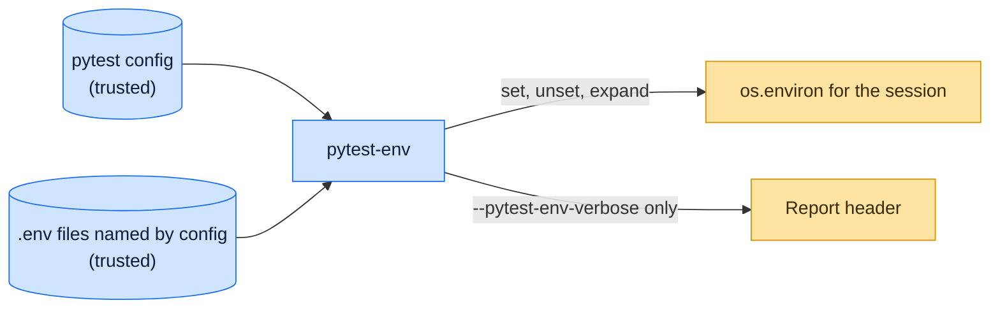

# Threat model

This model says what pytest-env trusts, where untrusted input enters, and which guarantees hold at each boundary, so a
report can be classified as a vulnerability or a bug. [SECURITY.md](SECURITY.md) covers reporting; if the two disagree,
SECURITY.md wins and we fix this file.

## How pytest-env works

Before tests are collected, pytest-env reads `env` entries from `pytest.toml`, `pyproject.toml` or `pytest.ini`, and
loads the `.env` files that `env_files` or `--envfile` name, resolved against the rootdir and parsed with python-dotenv.
It sets, unsets or keeps each variable, expanding `{VAR}` references unless the entry is raw. With
`--pytest-env-verbose` it prints each assignment, values included, in the report header.

## Compared with similar tools

We drew the boundary where comparable projects in other ecosystems draw theirs. The shared rule, stated by the
[Node.js threat model](https://github.com/nodejs/node/blob/main/SECURITY.md#the-nodejs-threat-model), is that a report
which first needs a trusted element compromised is out of scope; the first triage question, as
[DOMPurify](https://github.com/cure53/DOMPurify/blob/main/SECURITY.md#what-we-consider-a-vulnerability) puts it, is what
the attacker controls.

| Project                                                        | Language   | Where it draws the line                                                                                                                                              |
| -------------------------------------------------------------- | ---------- | -------------------------------------------------------------------------------------------------------------------------------------------------------------------- |
| [direnv](https://direnv.net/man/direnv.1.html)                 | Go         | Treats `.envrc` as untrusted until `direnv allow`, because it executes it; pytest-env's `.env` files are data named by trusted configuration and are never executed. |
| [dotenv](https://github.com/motdotla/dotenv/security/policy)   | JavaScript | Parses `.env` files as data; publishes a reporting policy only.                                                                                                      |
| [Vitest](https://github.com/vitest-dev/vitest/security/policy) | JavaScript | Trusts the developer, the config file, plugins and every project file; only reports that need no trusted element compromised count.                                  |
| [Jest](https://github.com/jestjs/jest/security/policy)         | JavaScript | Test runner; private reports with an escalation path, and no separate threat model.                                                                                  |

## Trusted

An attacker who controls any of these already has what pytest-env could give them:

- The pytest configuration and command line, including `env`, `env_files` and `--envfile`.
- The `.env` files they name, and the process environment used for `{VAR}` expansion.
- The tests, which run with the variables set.

## Untrusted inputs

| Input                     | Comes from                     | What pytest-env guarantees                                                                                                                |
| ------------------------- | ------------------------------ | ----------------------------------------------------------------------------------------------------------------------------------------- |
| Variable values in output | Secrets placed in `.env` files | Not printed unless `--pytest-env-verbose` is given.                                                                                       |
| Relative `.env` paths     | Configuration                  | Resolved against the pytest rootdir and never searched for elsewhere; a missing `--envfile` raises, a missing configured file is skipped. |

## Threats and controls

| STRIDE                 | Threat                                           | Control                                              |
| ---------------------- | ------------------------------------------------ | ---------------------------------------------------- |
| Information disclosure | A secret from `.env` appears in a public CI log. | Values are printed only with `--pytest-env-verbose`. |
| Tampering              | A `.env` file from another directory is loaded.  | Only named files, resolved against the rootdir.      |

## Release chain

Releases run on the shared [tox-dev/github-workflows](https://github.com/tox-dev/github-workflows) pipeline. A release
App, not a person, pushes the release commit and tag; the build installs its tools hash-checked from `pylock.toml` with
a seven-day upload cooldown; PyPI receives the files through
[trusted publishing](https://docs.pypi.org/trusted-publishers/) with attestations, and the GitHub Release is immutable.
Every workflow pins third-party actions to a commit SHA.

## Vulnerability or bug

| Report                                                                | Verdict             | Why                           |
| --------------------------------------------------------------------- | ------------------- | ----------------------------- |
| A secret shows up in the report header without `--pytest-env-verbose` | Vulnerability       | Output guarantee broken.      |
| `FOO = "{HOME}"` expands to the home directory                        | Not a vulnerability | Documented expansion.         |
| A malicious `pytest.ini` sets `LD_PRELOAD`                            | Not a vulnerability | The configuration is trusted. |

## Accepted risks

- `--pytest-env-verbose` prints values, secrets included; do not enable it with secrets in public logs.

## Keeping this current

Revisit this model when pytest-env gains a new input source, network access, a new way to run code, or a new place it
writes to, and whenever an advisory is published.
